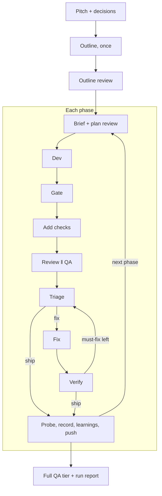

# How it works



## Outline once, brief each phase

`orch plan` splits the pitch into an outline (`plan.md` in the run dir): one row per phase with
a deliverable, the requirement ids it covers, its dependencies, a size, and a scenario.
Code then checks that every requirement is covered and that no phase depends on a later
one, and a read-only session reviews the outline.

Each phase gets its detailed brief only when it is about to run, written from the code
as it is then. That keeps every brief in step with the code, and lets later phases use
what earlier ones learned.

## The phase loop

| Step | Who | What |
| --- | --- | --- |
| Brief | lead, then plan review | Goal, acceptance criteria, functional QA, baseline |
| Dev | fresh session | Implements the brief with tests, in small commits |
| Gate | code, no model | `gate_cmd`, plus diff checks: no new skips, no deleted tests |
| Add checks | lead | Turns each deviation into one extra check |
| Review ‖ QA | two fresh sessions | In parallel, each in its own worktree |
| Triage | lead | Ship, or write a fix brief |
| Fix → Verify | fresh sessions | At most `max_fix_rounds` rounds, then `blocked` |
| Record | code and lead | Log, learnings, handoff, commit, push |

## Scenarios

A scenario lists the steps a phase runs. The planner picks one for each phase and gives
a reason:

| Scenario | Fits |
| --- | --- |
| `full` | The default, most phases |
| `small` | Low-risk phases: docs, config, one module |
| `ui` | Phases that change pages; QA drives a browser |
| `real-data` | Phases that touch real data or paid APIs |
| `spike` | An open question that later phases depend on |

Every step's prompt is a skill (`orch-dev`, `orch-review`, ...). Scenarios, templates,
models and effort can be overridden per user, per repo or per task; see
[Tune](reference/tune.md).

## Where things live

Run files stay out of the project repo, so the run branch carries code only. They
live in orch's home (`~/.orch`, or `$ORCH_HOME`, or `home` in
`~/.config/orch/config.toml`):

```
~/.orch/sessions.jsonl                       # one line per session, every repo and run
~/.orch/repos/<owner>/<repo>/
  process-learnings.md                       # fed to every later brief
  backlog.md                                 # deferred findings
  runs/<run-id>/plan.md                      # outline
  runs/<run-id>/phases/03-dedupe/brief.md    # written just before the phase
  runs/<run-id>/phases/03-dedupe/log.md      # every step's JSON report, verbatim
  runs/<run-id>/state.json                   # orch-owned; PROGRESS.md is rendered from it
  runs/<run-id>/report.md                    # the run report
```

The repo keeps `.orch/config.toml`, `.orch/scenarios/`, `.orch/skills/` and any
hand-written briefs. On a machine whose home does not last (Claude Code on the web,
CI), set `home = "repo"`: the same tree goes in `.orch/runs/` and is committed on
the run branch. `orch migrate` moves run files an older orch left in `.orch/`.
