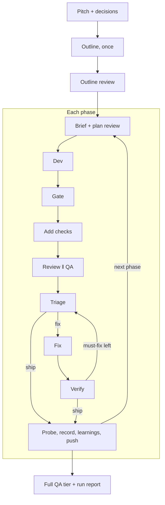

# orch

The plan below was written and reviewed in a Claude Doc
([orch plan v2](https://claude.ai/artifact/5VgzRCtXjTTbDR91ic59G1)) between
2026-10-28 and 2026-10-29. This file is now the source of truth; the doc is no longer
updated. Related: [orch-cloud-logs](orch-cloud-logs.md) (keeping session logs when orch
runs in the cloud). Next step: the user creates the orch repo, then this plan seeds
its `docs/`.


`orch` takes a shaped pitch and delivers it phase by phase with Claude Code. It splits the pitch into an outline of phases once, then for each phase writes a detailed brief from the code as it is at that moment, reviews it, and runs it: dev, review and QA in parallel, fix, verify. Code owns the control flow and the state; lead sessions make the judgment calls; worker sessions do the rest. The loop is modelled on [happytube](happytube.md), which ran 8 phases this way by hand.

## At a glance



The outline is made once. Each phase then starts with its own brief, written from the code as it is, and the lead makes the calls in between: which extra checks to run, what to fix, and when to ship. Every finished phase is pushed.

## Input: the shaped pitch

orch starts where the shape skill stops. It reads files in the project repo and never asks for chat context.

| File | Written by | What orch uses it for |
| --- | --- | --- |
| `docs/pitch.md` | shape skill | The requirement: problem, appetite (how much work it is worth), the solution at the level of behaviour, rabbit holes, no-gos. Not an implementation plan |
| `docs/decisions/NNNN-*.md` | shape skill, then you | Architectural decisions every phase must follow. Newer wins |
| `docs/architecture.md` | shape skill | Where things go. Optional for a first run |
| `QA.md` | shape skill or `orch init` | Tiers (commands + `expect`), oracles with `confirmed` / `proposed` status, the not-evidence list |

"Pitch" fits well: it is the Shape Up term for exactly this kind of document, a shaped solution with boundaries and no task list. To keep it apart from the one-line `pitch:` frontmatter field, the file is `docs/pitch.md` and the field stays the summary.

What orch needs from the pitch, so the shape skill should guarantee it:

- Requirements written as observable behaviour ("a CSV with duplicate keys is rejected with a message naming the key"), each with a short id (`R1`, `R2`) so phases can point at them.
- No-gos and appetite stated explicitly, because the planner uses them to cut scope.
- At least one reference case or invariant per core requirement, even if only `proposed`. These become the functional QA.

## Planning: outline once, brief each phase

The pitch is split once into an outline. Each phase gets its detailed brief only when it is about to run, written from the code as it is then, the earlier phases' handoffs and the process learnings so far. That keeps every brief matched to the current code by construction, and it lets later phases use what earlier ones found.

### `orch plan`: the outline

1. **Outline** (fresh session, strongest model). Reads the pitch, decisions, architecture, `QA.md` and the code. Returns one row per phase: title, a one-or-two-sentence deliverable, the requirement ids it covers, what it depends on, a size, and a scenario and approach with a one-line reason (see Scenarios and templates).
2. **Checks in code.** Every requirement id is covered, no phase depends on a later one, and the phase count and sizes are within bounds. One retry on failure.
3. **Outline review** (fresh session, read-only). No-gos and appetite respected, decisions followed, each phase fits one session, each scenario fits its phase's risk, and the order keeps the gate green after every phase. One revision.

The result is `plan.md` in the run dir (see Files). There is no approval stop; `orch plan --pause` stops there when you want to read it first.

### Before each phase: the brief

The lead session (see the phase loop) writes the brief, then a separate session reviews it.

1. **Open design choices.** If the phase has choices the pitch and decisions leave open, the lead asks you once, all questions in one batch, each with a recommended option. Everything else it settles itself under "settled by orch, dev may argue in deviations". While a question waits, the run is paused as `needs-user`; `--auto-decide` takes the recommended options instead.
2. **Brief.** Written to `phases/NN-slug/brief.md` in the run dir, with the sections below.
3. **Plan review** (fresh session, can run commands, edit tools removed). Does the brief match today's code (every file, module and command it names exists or is marked new; nothing is already built)? Does the functional QA make sense: it runs every check now, a check for new behaviour must fail, one that already passes proves nothing, one that can't run is fixed now? Is it faithful to the pitch and decisions? Does it fit one session?
4. **Revise.** The lead fixes blocking findings and the review runs again, at most two rounds. A blocking finding that survives stops the run as `needs-replan`.

### The brief

| Section | Content |
| --- | --- |
| Goal | One or two sentences, in user-visible terms |
| Covers | Requirement ids from the pitch |
| Settled with you | The answers to this phase's design question, if there was one |
| Settled by orch | Defaults dev may argue against in `deviations`, plus the standard clause: if a settled fact or rule turns out wrong, flag it in `deviations`, don't silently switch |
| Failure scenarios | The cases dev must design for: one item fails, a quota runs out mid-run, a rerun the next day, malformed input |
| Safety rules | The threat model when the phase writes files, serves pages or handles keys |
| Real data and credentials | A one-call probe before any batch, a budget cap, stop and report on a credential failure, commit nothing from a scratch run |
| Acceptance | Numbered, observable criteria (`A1`, `A2`) |
| Functional QA | Per criterion: a command, a reference case, an invariant or a bound with units, each `confirmed` or `proposed`, with at least one negative control. A browser check for UI phases |
| Tests to write | Behaviours that need automated tests |
| Baseline | Test count, coverage and check status at the start, so every change in them must be explained |

### Files

Run files live in orch's home, not in the project repo, so the run branch (and the PR) carries code only. The home is `$ORCH_HOME`, else `home` in the user's `~/.config/orch/config.toml`, else `~/.orch`. `home = "repo"` keeps the same tree under the repo's `.orch/` and commits it on the run branch, for machines whose home directory does not last (Claude Code on the web, CI). The repo keeps only what humans write: `.orch/config.toml`, `.orch/scenarios/`, `.orch/skills/` and hand-written briefs (`.orch/phases/NN-slug/brief.md`, copied into the run when it starts).

```
~/.orch/sessions.jsonl                          # one line per session, every repo and run
~/.orch/repos/<owner>/<repo>/                   # key from the remote URL (else the repo dir name)
  process-learnings.md                          # cumulative, fed to every later brief
  backlog.md                                    # deferred findings
  cache/                                        # materialized skills
  runs/<run-id>/plan.md                         # outline: phases and requirement coverage
  runs/<run-id>/phases/03-dedupe/brief.md       # written just before the phase
  runs/<run-id>/phases/03-dedupe/log.md         # every step's JSON report, verbatim
  runs/<run-id>/phases/03-dedupe/learnings.md
  runs/<run-id>/state.json                      # orch-owned; PROGRESS.md is rendered from it
  runs/<run-id>/report.md                       # the run report
```

The current run is the one whose `orch/<run-id>` branch is checked out, else the newest unfinished one; `orch status --run <id>` picks another. Sessions get the repo's home dir with `--add-dir` and are told about run files by absolute path, worktree sessions included. Since `--add-dir` is writable and the briefs are outside git, orch hashes a phase's briefs before each session and puts back any the session changed, failing the step (the in-repo `protected` globs still go through the gate's commit check). `orch migrate` moves run files an older orch left in `.orch/` to the home.

## The phase loop: `orch run`

Code runs the loop and writes all state. Worker sessions build and check. The **lead**, a fresh session at each of its steps that reads the phase docs its inputs list, makes the judgment calls that the human-driven orchestrator made in happytube: which extra checks to run, what to fix, which fix design to pick, and when to ship. The lead writes only orch's own files, through structured output. The steps below are the default full scenario; the planner can pick another per phase.

0. **Brief** (lead, then plan review), as above.
1. **Dev** (fresh session). Implements the brief with tests in small commits, running the full typecheck before each one (the staged-only hook misses cross-file breakage). A real-data run is exploratory and commits nothing. Report: commits, tests against the baseline with every change explained, design, real-run results, `deviations` (including any workaround) and `unresolved_issues`.
2. **Gate** (code, no model). `gate_cmd` plus diff checks for what the QA principles call not evidence: a new `skip` or `xfail`, a deleted test, edits to `QA.md` or confirmed oracles.
3. **Add checks** (lead). Turns each deviation and each unresolved issue into one extra check, routed to exactly one agent: logic to review, runtime to QA. In happytube this was the most reliable source of medium findings.
4. **Review ‖ QA** (two fresh sessions in parallel, each in its own detached worktree with its own `uv sync`). Review reads the code for logic, reproduces where cheap and checks external SDK behaviour against the SDK source, not the fakes. QA runs the brief's functional QA and the added runtime checks, with a browser for UI phases, and may add oracles as `proposed`. Both report a verdict (`ship` or `fix`), numbered findings (`R1`, `Q1`) with severity and a repro, the checks they ran with evidence, and preexisting problems separately.
5. **Triage** (lead). If both say `ship`, go to 8. Otherwise it writes the fix brief: must-fix, also-fix (preexisting problems worth promoting, such as a security issue) and do-NOT-fix; it merges duplicates (`R2 = Q1`), picks one design per finding, and names the repro verify should use.
6. **Fix** (fresh session, with the fix brief). Same report as dev.
7. **Verify** (one fresh session doing review and QA together). Re-traces each fix end to end, judges each of the fix's deviations, and reruns only the checks whose inputs changed plus the fix-specific ones. If a must-fix remains, back to 5; after `max_fix_rounds` (default 2) the phase is `blocked`. In happytube one fix round plus verify was enough in all 8 phases, and verify always found one to three lows.
8. **Probe** (only for phases that touch real data or paid APIs). A small real run on the final code; the lead eyeballs the output.
9. **Record** (code and lead). orch writes every report into `log.md`, moves deferred findings to the backlog and pushes the run branch. The lead writes the phase learnings, appends the process lessons to `process-learnings.md`, and writes the handoff for the next brief.

| Session | Fresh or resumed | Tools | Model (default) |
| --- | --- | --- | --- |
| Lead | fresh at each step; the phase docs carry its state | read + Bash, no code edits | strongest |
| Outline, outline review, plan review | fresh | read + Bash, no edits | strongest |
| Dev, fix | fresh | all | mid-tier |
| Review | fresh | read + Bash for repros, no edits | strongest |
| QA, verify | fresh | read + Bash, no edits | mid-tier |

## Scenarios and templates

The loop above is the default scenario, not the only one. A scenario lists the steps a phase runs and the template each step uses, so changing how phases are built means editing a file, not orch's code.

### Scenarios

A scenario is a small file: the steps in order, and for each step its template, tools, model and effort. orch ships these:

| Scenario | Steps | Fits |
| --- | --- | --- |
| full | brief → dev → gate → add checks → review ‖ QA → triage → fix → verify → record | The default, most phases |
| small | brief → dev → gate → one combined review and QA → fix → gate → record | Low-risk phases: docs, config, one module |
| ui | full, with QA driving a browser at desktop and phone width | Phases that change pages |
| real-data | full, plus the probe before record | Phases that touch real data or paid APIs |
| spike | brief → dev on a throwaway branch → findings report | An open question later phases depend on |

A scenario can extend another and change only what differs, for example `extends = "full"`, a different QA template and one extra step. A step can also carry `extra`: a few lines of task-specific instructions passed to its template, such as "also open the CSV export in LibreOffice".

### Templates are skills

Each step's prompt is a skill with an `orch-` name: orch-outline, orch-brief, orch-plan-review, orch-dev, orch-add-checks, orch-review, orch-qa, orch-triage, orch-fix, orch-verify, orch-learnings. orch starts a session as `claude -p "/orch-dev .orch/phases/03-import/brief.md"`, and the skill gets the paths through `$ARGUMENTS`. The template holds the instructions; the facts stay in files, so files remain the contract.

Skills fit because the same template works when you run one step by hand in an interactive session (`/orch-review <brief>`), a skill can bundle helper files such as a checklist, and Claude Code already knows how to load them. The JSON schema for each step's report stays in orch's code, so an edited template can't break parsing.

### Overrides

Each layer overrides the one above it, per scenario, template, model and effort:

1. Defaults shipped with orch.
2. User: `~/.config/orch/scenarios/` and `~/.config/orch/skills/`.
3. Repo: `.orch/scenarios/` and `.orch/skills/`, committed with the project.
4. Task: the pitch frontmatter (for example `scenario: small` for the whole run), one phase's row in the outline, or `orch run --scenario`.

orch resolves the layers itself. Claude Code ranks a personal skill above a project one, the opposite of what is needed here, so orch copies the winning version of each template into the run's own folder and loads it from there with `--add-dir`, under the name `orchskill-<template>`: a live test showed a personal `~/.claude/skills/<template>` otherwise wins over the `--add-dir` copy. `orch config` prints, for every step, the scenario and template in use and the layer each came from. `orch eject orch-qa` copies a default template into `.orch/skills/` so you can edit it.

### The planner chooses

The outline picks a scenario and an approach for each phase, with a one-line reason: "small, extend the existing importer, no new module" or "spike first, the API's rate limits are unknown". The outline review checks the choice against the phase's size and risk; a phase that calls a paid API without real-data is a finding. If the code turns out different when the brief is written, the lead may switch the scenario; that counts as a replan and goes in the run report.

A scenario set by a repo or task is a default: the planner may pick another for a phase, with its reason in the outline and the run report (decided 2026-10-29).

### Model and effort

Every step runs with a model and an effort level (`--model`, `--effort`). orch's defaults are in the sessions table above, and every layer can change them per step, like templates: your user config for your usual choices, the repo's scenarios, the pitch for the whole run, an outline row for one phase. For a single run, `orch run --set dev.model=<model> --set review.effort=high` changes them without editing a file.

The planner may raise the effort for a hard phase or lower it for a small one, with a reason, the same way it picks a scenario. Values you pass to `orch run` it leaves alone, since you chose them for this run. `orch config` shows each step's model and effort and the layer they came from.

Some rules hold in every scenario, and orch refuses a scenario that breaks them: the gate runs after every step that changes code, dev's work is checked by a different session, only humans confirm oracles, every phase ends with record and push, and report schemas belong to orch.

## Finishing, pausing and resuming

A run ends with a branch you can review, not with a merge.

**After the last phase:**

- orch runs the slowest QA tier (`full`) and, if `QA.md` defines one, the diff against main.
- It writes a run report: every requirement id with the phase that covered it and its QA evidence, the requirements left out, tokens by phase and role, fix rounds used, the plan issues raised, and every mid-run replan with what it changed in which briefs, the backlog of deferred findings, and the process lessons added during the run.
- It leaves the branch for you. With `open_pr = true` it opens the PR with `gh` (title from the pitch, body from the run report, `Fixes #N` when the pitch names its source issue); it never merges.

**When a run stops:**

| Cause | State | What happens next |
| --- | --- | --- |
| A design question for you, or a credential only you can fix | `needs-user` | orch prints what it needs. You answer or fix it, then `orch run` continues |
| Ctrl+C | `paused`, session id saved | orch forwards SIGINT so the turn is recorded; `orch run` resumes that session |
| Usage limit | `paused`, reset time saved | Exit code 75. `orch run --wait` sleeps until the reset time from the error, then resumes |
| Fix rounds used up | `blocked` | Run stops. You fix by hand or edit the brief, then `orch run` continues from that phase |
| The brief can't pass plan review | `needs-replan` | Run stops. You edit the outline or the pitch, then `orch plan --from N` |
| Machine gone (cloud session reclaimed, laptop died) | last pushed phase | With `home = "repo"`: on any machine, clone, check out the run branch, `orch run` continues from `state.json`. With a home outside the repo the run state stays on that machine (back the home up, e.g. as a git repo) |
| Session crash or bad output | `failed` | One retry, then stop |

Resume never needs parsing: orch assigns each session id itself with `--session-id` before starting it.

## Claude Code usage

Every session is `claude -p` with flags built in one function, checked against Claude Code 2.1.312. This also covers what the review of the first plan found.

| Need | How |
| --- | --- |
| Structured result | `--output-format json --json-schema <schema>`. A missing `structured_output` counts as a failed step |
| Resume without parsing | `--session-id <uuid>` on start, `--resume <uuid>` for fixes |
| Unattended permissions | `--permission-mode auto --permission-prompts none` (since v2.1.302 `-p` defaults to Manual mode, which would deny almost everything) |
| Read-only roles | `--tools Read,Grep,Glob` removes tools. `--allowedTools` only pre-approves and does not restrict |
| QA role without edits | `--tools Read,Grep,Glob,Bash` |
| Model and effort per role | `--model`, `--effort` (both exist; no fallback needed) |
| Runaway guard | `--max-budget-usd` per session, set high. Reporting stays the main tool |
| Overloads | `--fallback-model` |
| Cost per step | Read `total_cost_usd` and usage from the JSON. On a resumed session these are totals for the whole conversation, so orch stores the previous total and subtracts it |
| Usage limit | Detect it from the error result. Claude Code auto-waits only in interactive sessions, so orch handles the wait |
| CLAUDE.md and hooks load | No `--bare`. The docs say `--bare` will become the default for `-p`; the smoke test checks that CLAUDE.md loaded, and orch logs `claude --version` |

What orch doesn't do: parallel phases, agent teams, a UI, multi-repo, merging. A live usage-percentage guard is deferred: the `rate_limit_event` in stream-json carries it but is not formally documented.

**Running in a claude.ai/code cloud session.** Tested on 2026-10-28: `claude -p` is installed and signed in there, and `--json-schema`, `--session-id` and the cost fields work. Three rules follow:

- Always pass `--session-id` and clear `CLAUDE_CODE_SESSION_ID`. Without that, the child session reused the parent cloud session's id.
- Push after every phase (step 6). Background commands there are capped at 2 hours and the machine can be reclaimed, so resume must work from a fresh clone.
- Prefer exit 75 and a later rerun over `--wait`: waiting hours for a usage reset inside a cloud session is fragile.

## Build order

Six small phases get a working tool; everything else waits for evidence from real runs. Each phase ends in one commit with its own acceptance checks, and each later phase is checked against a hand-run of the same loop in happytube.

1. **Session wrapper and state.** `claude.py` builds argv from role config and returns a result with session id, cost delta, usage, structured output and error kind (`usage_limit`, `auth`, `other`). Prompts (orch- skills), model and effort are resolved per step across the layers (defaults, user, repo, task), and orch config shows where each came from. A fake `claude` executable returns canned JSON. `state.json` with PROGRESS.md rendered from it. *Acceptance:* unit tests for argv, parsing, missing structured output, each error kind and the cost delta on resume, and a repo template beating a user one; one live smoke test that also checks CLAUDE.md loaded and that the resolved skill is the one that ran.
2. **Minimal loop.** Hand-written brief → dev → gate (with the diff checks) → fix → record and push, on a run branch. The steps come from a scenario file, so later build phases add steps by adding scenarios. *Acceptance:* with fake claude, three phases finish, a gate failing past the cap ends `blocked`, and a run resumes from a fresh clone of the pushed branch. Live: a two-phase toy plan in a scratch repo.
3. **Review ‖ QA and verify.** Parallel sessions in detached worktrees, the report schemas with numbered findings, the combined verify, `log.md`. *Acceptance:* fake scenarios for both `ship`, a `fix` then `ship`, rounds exhausted, malformed output, and two worktrees running tests at once without collisions.
4. **Lead session.** Add checks after dev, triage into a fix brief, learnings and handoff after record. *Acceptance:* with fake claude, a deviation becomes exactly one routed check, duplicates merge, do-NOT-fix items stay unfixed. Live: rerun one finished happytube phase's dev report through the lead and compare its checks and fix brief with the hand-written ones.
5. **`orch plan` and per-phase briefs.** Outline with a scenario and approach per phase, checks in code, outline review; before each phase the design question, the brief and the plan review with the QA dry run. *Acceptance:* fake scenarios for an uncovered requirement, a QA check that already passes, a brief naming a missing file, a paid-API phase without the real-data scenario, a planner change to a repo's default scenario or effort that must carry a reason, and a design question that pauses as `needs-user`. Live: outline a small real pitch and read the first brief.
6. **Stops, probe and the run report.** SIGINT forwarding, `paused` and resume, usage-limit exit 75 and `--wait`, `needs-user` for credentials, the probe step, the final run report. *Acceptance:* interrupt then resume and usage limit then resume with fake claude; one real run of a five-phase pitch.

From phase 4 on, orch can build its own later phases from a pitch of its own.

**Deferred, each with the evidence that would justify it:**

| Feature | Add it when |
| --- | --- |
| Lead fixes doc or cosmetic issues itself after `ship` (happytube did; code always went to the backlog) | Runs show many one-line doc fixes waiting on a loop |
| Simplify pass | Run reports show code growing faster than the work explains |
| Live usage guard | Reactive waits after a usage limit cost real time |
| `/code-review` instead of the custom reviewer | A side-by-side run shows it finds more real problems |
| Opening a PR at the end | Branch handoff becomes the slow step |

## Where the design comes from

The loop, the brief sections, the report fields and most defaults come from happytube's `docs/process-learnings.md`: 8 phases (0 to 5c) run by hand with the same shape, each phase recording what worked and answering the open questions of the ones before. Two things orch adds on top: the lead session, which takes over the judgment the human-driven orchestrator gave, and the plan review that dry-runs the QA checks. The main risk is that the lead is weaker than that orchestrator was, which is why build phase 4 compares its output with the hand-written briefs of a finished phase.

## Decisions and open questions

**Decisions this plan makes** (kept from the first plan where they held up):

| Decision | Why |
| --- | --- |
| Code owns the loop and all state; a lead session makes the judgment calls through structured output | A deterministic record, plus the judgment a human orchestrator gave in happytube |
| Files are the contract; prompts are pointers | Each session reads the brief and the repo, not assembled chat context |
| Outline once, brief each phase just before it runs | Briefs match the code as it is; later phases use what earlier ones found |
| No approval of the split; a plan review that dry-runs the QA checks | A dry run catches more than a quick human read; `--pause` stays available |
| Open design choices go to you once per phase, batched, with a recommended option each | In happytube no finding was about shape after this; `--auto-decide` skips it |
| QA checks are written before the code, by a different session from dev | Dev doesn't grade its own work |
| Only humans confirm oracles | From the QA principles; agents propose |
| Review and QA run in parallel and stay separate; round 2 is one combined verify | Each catches what the other can't; one fix round plus verify was enough in all 8 happytube phases |
| Dev's real-data runs are exploratory; data is committed only after verify | Data from a rule that review overturns would otherwise stay in the repo |
| Only you fix credentials | Agents that work around a bad key do more harm than a pause |
| Gate is an opaque command, plus diff checks and a full typecheck in code | QA tiers evolve in the project; the not-evidence checks are cheap and certain |
| Report, with a high per-session budget cap | Tokens are the metric; the cap only stops runaways |
| Run on a branch, push after every phase, never merge | Nothing is lost when a machine goes away; your main branch is never touched |
| Python 3.11+, small dependencies allowed | `uv tool install` makes them free |
| Phase steps come from scenarios, and step prompts are orch- skills, overridable per user, repo and task; orch resolves the layers itself (2026-10-29) | Changing the process means editing a file. Claude Code ranks personal skills above project ones, the reverse of what a repo override needs |
| The planner picks a scenario and approach per phase; code enforces the rules every scenario keeps. Repo and task settings are defaults, not pins; model and effort are set per step at any layer (2026-10-29) | The planner knows the phase; the fixed rules keep any scenario honest |

**Open questions:**

- [ ] Does the shape skill write `docs/pitch.md` with requirement ids and at least one proposed oracle per core requirement? If not, orch's split step has to invent them, which is weaker.
- [x] Decided 2026-10-28: the document is called the pitch, in docs/pitch.md. The plan uses pitch.
- [x] Where does orch live: decided 2026-10-28, its own repo. With the name settled as orch, you can create it.
- [x] Name: it is a coding tool. If it goes on PyPI it needs a rare animal name; `orch` is a working name. Decided 2026-10-28: local use only for now, not on PyPI, so it keeps a plain name; orch works. Revisit if it ever gets published.
- [x] When replanning mid-run changes a later phase a lot, should orch still continue on its own, or stop and tell you? Decided 2026-10-28: continue, and report each replan with what changed in the run report.
- [x] Should the functional QA session be allowed to add `proposed` oracles it discovers, for you to confirm later? Decided 2026-10-28: yes.
- [ ] Default for a phase's open design choices: pause and ask you, or take the recommended options (`--auto-decide`) and list them in the run report?
- [x] Lead session: one resumed session per phase, or fresh at each step? Decided 2026-11-19: fresh at each step. The phase docs (brief, reports, log) already carry what the lead needs, and resuming was not cheaper: each lead step passes its own `--json-schema`, which changes the tool definitions and invalidates the prompt cache, so every resume rewrote the whole context (up to ~330k tokens on opus). On the deedum run the lead steps cost about $160 of $189. A rejected answer still resumes the same session within its step.
